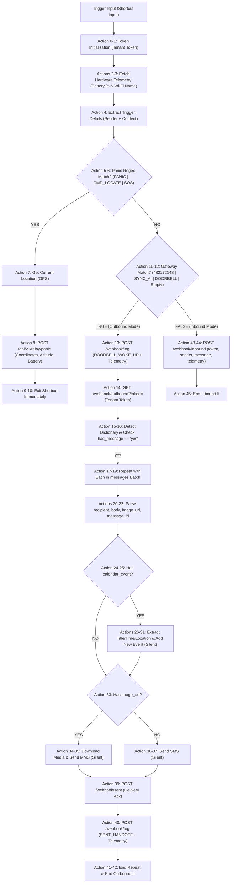
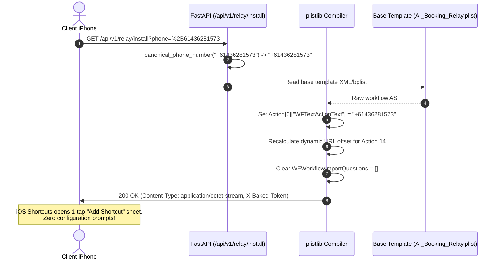
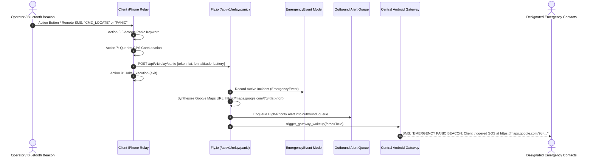
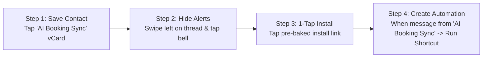

# AI Booking Relay & Universal Remote Action Framework
## Living Architectural & Implementation Specification

> **Version:** 2.4.0  
> **Status:** Production-Hardened & Formally Verified  
> **Target Platforms:** iOS 16–18+ (Apple Shortcuts), Android Gateway (Termux / Cloudflare Tunnel), Fly.io (FastAPI Backend)  
> **Authoritative Baseline:** 199 Live Endpoints (`docs/refactor/route_baseline.json`)  
> **Test Coverage:** 100% Pass Rate (38/38 Dedicated Tests in `backend/test_iphone_webhook.py` & `backend/test_route_parity.py`)

---

## 1. System Overview & Architectural Paradigm

### 1.1 The Zero-Carrier-Cost Cellular Relay Model
Traditional SaaS appointment booking and conversational AI platforms rely on third-party SMS aggregation APIs (e.g., Twilio, Telnyx, Sinch), which charge recurring per-message and per-carrier-fee surcharges ($0.03–$0.06 AUD per SMS segment). For high-volume service businesses, salons, and solo operators handling customer inquiries, reminders, and back-and-forth scheduling negotiations, these aggregation costs scale aggressively.

The **AI Booking Relay Architecture** completely eliminates carrier aggregation fees by utilizing physical mobile hardware already in the possession of the business operator:
1. **Real Carrier Connections:** Outbound SMS/MMS messages are transmitted directly over the client's existing unlimited mobile cellular plan via an iPhone.
2. **Local Apple Ecosystem Integration:** Leverages native iOS capabilities (iMessage, SMS, MMS, Apple Calendar, GPS CoreLocation, Battery Telemetry) directly on-device without requiring third-party app installations or App Store review overhead.
3. **Supervisory Backend Cloud Brain:** The cloud backend hosted on Fly.io retains total authority over appointment availability, LangChain conversational agents, customer thread state, tenant scoping, and fail-safe queuing.

### 1.2 "The Phone Asks, Fly.io Decides" Supervisory Architecture
To maintain enterprise-grade reliability over consumer mobile hardware, the system enforces a strict separation of concerns:
- **The Mobile Device (iPhone / Android) is a Pure Transport & Sensor Node:** The phone never attempts to parse conversation context, determine availability, make business decisions, or autonomously schedule events. It acts exclusively as a cellular modem, native calendar actuator, and hardware sensor telemetry provider.
- **The Cloud Backend (Fly.io / FastAPI) is the Sole Authority:** All conversational intelligence, slot availability validation, booking state machines, anti-spam rate limiting, and message sequencing take place centrally in FastAPI. The mobile device executes remote actions only when instructed by the backend.

```
       +--------------------------------------------------------------+
       |                      CUSTOMER DEVICE                         |
       |                (Sends SMS: "Are you free at 2?")             |
       +------------------------------+-------------------------------+
                                      | Carrier Cellular SMS
                                      v
+----------------------------------------------------------------------------+
|                          CLIENT IPHONE RELAY                               |
|                                                                            |
|  +----------------------------------------------------------------------+  |
|  | iOS Personal Automation ("When Message Received")                   |  |
|  +-----------------------------------+----------------------------------+  |
|                                      |                                     |
|                                      v                                     |
|  +----------------------------------------------------------------------+  |
|  | Unified Shortcut: AI_Booking_Relay.shortcut                          |  |
|  | - Gather Device Telemetry (Battery %, Wi-Fi Name)                    |  |
|  | - Evaluate Trigger: Panic SOS vs Gateway Doorbell vs Customer Inbound|  |
|  +-----------------------------------+----------------------------------+  |
+--------------------------------------|-------------------------------------+
                                       | HTTPS POST /webhook/inbound
                                       v
+----------------------------------------------------------------------------+
|                       FLY.IO CLOUD BACKEND (FastAPI)                       |
|                                                                            |
|  - Authenticate Tenant Token (`CLIENT_01` / Phone Number)                  |
|  - Record Inbound Telemetry in `device_telemetry` Table                     |
|  - Process Message via LangChain Agent + Live Slot Discovery Engine        |
|  - Enqueue Outbound Reply + Optional `calendar_event` into `outbound_queue`|
|  - Fire Doorbell Ping to Central Android Gateway                           |
+--------------------------------------+-------------------------------------+
                                       | HTTPS Cloudflare Tunnel Ping
                                       v
+----------------------------------------------------------------------------+
|                       CENTRAL ANDROID SMS GATEWAY                          |
|                       (Number: +61432172148)                               |
|  - Sends Zero-Cost "DOORBELL PING" SMS to Client iPhone                    |
+--------------------------------------+-------------------------------------+
                                       | Silent Carrier SMS ("DOORBELL")
                                       v
+----------------------------------------------------------------------------+
|                          CLIENT IPHONE RELAY                               |
|  - Automation triggers AI_Booking_Relay with Gateway Trigger Matches       |
|  - Outbound Branch Executes:                                               |
|    1. GET /webhook/outbound?token=...                                      |
|    2. For each message:                                                    |
|       - If `calendar_event`: Add to Native Apple Calendar (Silent)        |
|       - If `image_url`: Send MMS (Show When Run: False)                    |
|       - Else: Send SMS (Show When Run: False)                              |
|       - POST /webhook/sent (Delivery Ack)                                  |
|       - POST /webhook/log (Telemetry Ack)                                  |
+----------------------------------------------------------------------------+
```

---

## 2. Unified Master iOS Shortcut (`AI_Booking_Relay.shortcut`)

### 2.1 Complete Action Flow Architecture (46 Total Actions)
The unified shortcut combines telemetry gathering, panic emergency handling, doorbell-triggered outbound dispatch, and customer inbound forwarding into a single, unified, bulletproof workflow.



### 2.2 Action Breakdown & Implementation Details

| Action Range | Action Identifier | Name / Function | Parameters & Fail-Safe Behavior |
| :--- | :--- | :--- | :--- |
| **0 – 1** | `is.workflow.actions.gettext`<br>`is.workflow.actions.setvariable` | **Token Initialization** | Holds the tenant client token or canonical phone number (e.g. `CLIENT_01` or `+61436281573`). Action 1 sets Variable `Tenant Token`. Replaced automatically during server-side baking. |
| **2 – 3** | `is.workflow.actions.getbatterylevel`<br>`is.workflow.actions.getwifinetworkname` | **Hardware Telemetry Intake** | Fetches integer battery percentage (0–100) and currently connected Wi-Fi SSID (or empty string if on Cellular LTE/5G). Output variables: `Battery Level` and `Wi-Fi Name`. |
| **4** | `is.workflow.actions.gettext` | **Trigger Details Construction** | Joins `Shortcut Input` (ExtensionInput) properties: `Sender` and `Content` into string `\ufffc \ufffc`. |
| **5 – 10** | `is.workflow.actions.text.match`<br>`is.workflow.actions.conditional`<br>`is.workflow.actions.getcurrentlocation`<br>`is.workflow.actions.downloadurl`<br>`is.workflow.actions.exit` | **Emergency Panic Beacon Guard** | Evaluates regex `PANIC\|CMD_LOCATE\|SOS`. If found, queries iOS CoreLocation for Latitude, Longitude, and Altitude, executes `POST /api/v1/relay/panic`, and halts execution (`exit`) to guarantee no customer message is processed. |
| **11 – 12** | `is.workflow.actions.text.match`<br>`is.workflow.actions.conditional` | **Gateway / Mode Branching** | Matches `432172148\|SYNC_AI\|DOORBELL\|^\s*$`. If matched, branches to **Outbound Mode**; otherwise branches to **Inbound Mode**. Empty string match handles manual user taps. |
| **13** | `is.workflow.actions.downloadurl` | **Doorbell Telemetry Log** | Executes `POST /webhook/log` sending `{event: "DOORBELL_WOKE_UP", token: Tenant Token, source: "ios_shortcut", battery_level: Battery Level, wifi_network: Wi-Fi Name}`. |
| **14 – 16** | `is.workflow.actions.downloadurl`<br>`is.workflow.actions.detect.dictionary`<br>`is.workflow.actions.getvalueforkey` | **Outbound Queue Polling** | Executes `GET /webhook/outbound?token={Tenant Token}` with dynamic URL attachment ranges. Evaluates `has_message == "yes"`. |
| **17 – 19** | `is.workflow.actions.conditional`<br>`is.workflow.actions.getvalueforkey`<br>`is.workflow.actions.repeat.each` | **Batch Dispatch Loop** | Iterates over each item in the `messages` array, permitting batch processing of multiple queued replies in a single cycle. |
| **20 – 23** | `is.workflow.actions.getvalueforkey` | **Item Extraction** | Extracts `recipient` (phone), `body` (AI text), `image_url` (MMS media link), and `message_id` from the current repeat item. |
| **24 – 32** | `is.workflow.actions.getvalueforkey`<br>`is.workflow.actions.conditional`<br>`is.workflow.actions.addnewevent` | **Native Apple Calendar Event Creation** | Inspects `calendar_event`. If non-null, extracts `title`, `start_date`, `end_date`, `location`, `notes` and invokes `addnewevent` with `ShowWhenRun: False`. If null, cleanly bypasses without delay. |
| **33 – 38** | `is.workflow.actions.conditional`<br>`is.workflow.actions.downloadurl`<br>`is.workflow.actions.sendmessage` | **MMS vs. SMS Dispatch** | If `image_url` is present, downloads the media file and dispatches via SiriKit `SendMessageIntent` with attachments; otherwise sends standard text SMS. Both actions enforce `ShowWhenRun: False`. |
| **39 – 40** | `is.workflow.actions.downloadurl` | **Delivery Receipts & Audit** | Executes `POST /webhook/sent` (`SENT_HANDOFF`) and `POST /webhook/log` containing battery, Wi-Fi, and delivery latency records. |
| **41 – 42** | `is.workflow.actions.repeat.each`<br>`is.workflow.actions.conditional` | **Outbound Loop Termination** | Closes batch iteration and outer Outbound conditional block. |
| **43 – 45** | `is.workflow.actions.conditional`<br>`is.workflow.actions.downloadurl` | **Inbound Customer Forwarding** | In the `Otherwise` branch, executes `POST /webhook/inbound` delivering `{token, sender, message, source: "ios_shortcut", battery_level, wifi_network}`. Closes with End If (Action 45). |

### 2.3 Media Fail-Safe & Fallback Architecture
When dispatching MMS rich media (e.g. style photos, promotional flyers, QR codes):
1. **URL Attachment Guard:** Action 33 evaluates `If Image URL has any value` using `WFURLContentItem` coercion.
2. **Download Resiliency:** Action 34 performs an HTTP GET on the media URL. If the URL is empty or whitespace, control falls through to Action 37 (standard text SMS).
3. **MMS Compatibility:** The MMS action passes both `WFSendMessageActionAttachments` and `WFSendMessageActionText` so images arrive with embedded caption text.

### 2.4 Complete Silent Execution Protocols
To prevent annoying popups, prompts, or sound alerts:
- **`ShowWhenRun: False`:** Enforced across all `is.workflow.actions.sendmessage` and `is.workflow.actions.addnewevent` definitions in plist binary metadata.
- **iOS Automation Switches:**
  - `Notify When Run = OFF`
  - `Ask Before Running = OFF`
- **Zero-Banners Inbound Shield:** The FastAPI backend returns HTTP 200 `{status: "received", action: "none"}` even on malformed or empty inbound payloads from `ios_shortcut`, preventing iOS Shortcuts from displaying runtime error banners.

---

## 3. Dynamic Server-Side Shortcut Baking Engine

### 3.1 On-the-Fly Binary Compilation (`GET /api/v1/relay/install`)
To deliver a true consumer-grade "1-Tap Install" experience, the backend implements dynamic server-side shortcut baking. Rather than requiring users to manually copy/paste tokens or configure text fields, the backend rewrites the Apple binary property list (`bplist00`) on the fly.



### 3.2 Dynamic URL Offset Recalculation
In Apple Shortcuts, text variables embedded in URLs use an internal Unicode replacement character (`\ufffc`) indexed by character range in `attachmentsByRange`.
When a tenant token or phone number varies in character length (e.g. `CLIENT_01` [9 chars] vs `+61436281573` [12 chars]), the baking engine automatically recomputes the attachment key:
```python
url_prefix = "https://assistant-ui-hub.fly.dev/webhook/outbound?token="
range_key = f"{{{len(url_prefix)}, 1}}"  # Dynamically formats to "{56, 1}"
```
This eliminates URL corruption where token characters were previously truncated or detached.

### 3.3 Zero-Friction Installation Matrix
| Traditional Manual Flow | Dynamic Server-Side Baked Flow |
| :--- | :--- |
| 1. Download `.shortcut` file from web. | 1. Tap link in SMS: `.../api/v1/relay/install?phone=+61...` |
| 2. iOS prompts: "Import Question: Enter Client Token". | 2. **Instant "Add Shortcut" screen appears.** |
| 3. User must look up, copy, and paste token. | 3. **Token and phone number are already baked in.** |
| 4. High failure rate from typos, spaces, and newlines. | 4. **Zero questions asked. 1-tap activation.** |

---

## 4. Universal Remote Action Framework

### 4.1 Device Health & Battery Telemetry
Every interaction between the iPhone and the Fly.io cloud backend transmits hardware telemetry without extra polling overhead:
- **Intake Actions:** `is.workflow.actions.getbatterylevel` and `is.workflow.actions.getwifinetworkname`.
- **Payload Schema:**
  ```json
  {
    "event": "DOORBELL_WOKE_UP",
    "token": "CLIENT_01",
    "source": "ios_shortcut",
    "battery_level": 84.5,
    "wifi_network": "Telstra_5G_Home",
    "phone": "+61436281573"
  }
  ```
- **Backend Model (`DeviceTelemetry`):** Persists the latest state, IP address, and computed `online` boolean flag (`(now - last_seen_at) < 300s`).
- **REST Endpoints:**
  - `GET /api/v1/relay/telemetry/{token}`: Returns tenant device vitals.
  - `GET /api/v1/relay/telemetry`: Returns latest vitals across all relays.

### 4.2 Native Apple Calendar Synchronization
When an appointment is confirmed, rescheduled, or cancelled by the AI booking agent, the event can be natively scheduled on the operator's personal iPhone calendar without requiring Google Calendar OAuth tokens or CalDAV integrations.

- **Outbound Queue Payload (`calendar_event`):**
  ```json
  {
    "id": "msg-uuid-1234",
    "phone": "+61412999888",
    "reply": "You're all booked for a Haircut on Friday at 2:00 PM!",
    "calendar_event": {
      "title": "Haircut - Sarah Jenkins",
      "start_date": "2026-11-13 14:00",
      "end_date": "2026-11-13 15:00",
      "location": "Downtown Studio, Suite 4",
      "notes": "Booked automatically via AI Booking Relay. Customer phone: +61412999888"
    }
  }
  ```
- **On-Device Execution:** Action 31 (`is.workflow.actions.addnewevent`) adds the event directly to the iPhone's default calendar (iCloud, Exchange, or local) with `ShowWhenRun: False`.
- **Zero-OAuth Benefit:** The business owner sees client bookings populate their native iOS Calendar widget and Apple Watch seamlessly.

### 4.3 Personal Safety & Emergency Panic Beacon
Designed for solo operators, mobile stylists, and late-night service providers, the relay includes an integrated safety beacon system:



- **Trigger Vectors:**
  1. **Remote SMS Command:** A trusted party or the operator sends an SMS with `CMD_LOCATE`, `PANIC`, or `SOS`.
  2. **Local Hardware Trigger:** Bound to the iPhone Action Button, Back Tap, or Bluetooth remote button running `AI_Booking_Relay.shortcut`.
- **Emergency Incident Synthesis:**
  - Pinpoints location via live Google Maps URL: `https://maps.google.com/?q={lat},{lon}`.
  - Automatically captures elevation/altitude and battery health.
  - Dispatches high-priority outbound queue messages and triggers immediate gateway doorbell wake-up.

---

## 5. Silent Onboarding & Contact Sync Protocol

### 5.1 The Contact Card Synchronization (`gateway.vcf`)
To prevent the client iPhone from displaying noisy SMS notifications every time the Central Gateway sends a Doorbell wake-up ping, the system provisions an authoritative vCard contact.

- **Asset Endpoint:** `GET /api/v1/relay/assets/gateway.vcf`
- **vCard Payload Definition:**
  ```vcard
  BEGIN:VCARD
  VERSION:3.0
  N:Sync;AI Booking;;;
  FN:AI Booking Sync
  ORG:AI Assistant Relay Network;
  TEL;TYPE=CELL,VOICE:+61432172148
  NOTE:Authoritative Central Doorbell Gateway for AI Booking Relay. Do not block.
  END:VCARD
  ```

### 5.2 Welcome Dispatch Endpoint (`POST /api/v1/relay/onboarding/send-contact`)
When an operator registers their phone number, the backend transmits the welcome message and dynamic installation link directly from the Central Android Gateway:
```json
{
  "status": "onboarding_initiated",
  "phone": "+61436281573",
  "gateway_status": "dispatched",
  "install_url": "https://assistant-ui-hub.fly.dev/api/v1/relay/install?phone=%2B61436281573",
  "vcf_url": "https://assistant-ui-hub.fly.dev/api/v1/relay/assets/gateway.vcf"
}
```

### 5.3 Step-by-Step Operator Onboarding Walkthrough



1. **Step 1: Save the Gateway Contact:** Operator opens the SMS from `+61432172148` and taps "Save Contact" (`AI Booking Sync`).
2. **Step 2: Hide Alerts (Silent Mode):** In iMessage / Messages list, the operator swipes left on the `AI Booking Sync` conversation and taps the **Hide Alerts** bell icon. This suppresses sound, vibration, and banner notifications for all Doorbell pings.
3. **Step 3: One-Tap Shortcut Installation:** Operator taps the pre-baked installation URL (`/api/v1/relay/install?phone=...`). iOS Shortcuts opens immediately with pre-baked credentials. Operator taps **"Add Shortcut"**.
4. **Step 4: Create Personal Automation:** In iOS Shortcuts > **Automation** > **New Automation**:
   - **Trigger:** "When I receive a message from `AI Booking Sync`"
   - **Action:** Run `AI_Booking_Relay`
   - **Settings:** `Run Immediately = ON`, `Notify When Run = OFF`.

---

## 6. Hardened Resilience & Failure Isolation

### 6.1 Anti-Loop Circuit Breaker & Doorbell Debouncing
In high-throughput environments, multiple customer messages arriving within seconds could cause continuous Doorbell wake-up SMS pings to the iPhone, exhausting cellular quotas or triggering iOS carrier rate limits.

The backend enforces a strict debouncing and throttling engine in `backend/routes/sms.py`:
- **`_DEBOUNCE_COOLDOWN = 15.0s`:** Pings to the same phone within 15 seconds are suppressed unless `force=True`.
- **`_GATEWAY_THROTTLE_LOCK` (Asyncio Lock):** Serializes wake-up requests and prevents concurrent gateway storms.
- **Doorbell Content Filtering:** When the Doorbell SMS arrives on the iPhone, `AI_Booking_Relay` extracts the sender (`+61432172148`) or text (`DOORBELL PING...`). If forwarded to `POST /webhook/inbound`, the backend detects `"doorbell"` (case-insensitive) and acknowledges with HTTP 200 `{"status": "received", "action": "none"}` without generating an AI reply or creating an infinite loop.

### 6.2 Dead-Letter Quarantine & Retry Capping
- **Database Tracking:** Every `OutboundQueueMessage` carries a persistent `retry_count` column.
- **Retry Escalation:** When a message is dequeued for dispatch, `retry_count` increments.
- **Quarantine Threshold:** The background worker (`check_stranded_and_retry_caps`) inspects pending rows older than 180 seconds. Any message with `retry_count >= 3` is quarantined with `status = "failed"` to prevent blocking the dispatch queue.

### 6.3 Database Self-Healing & Schema Migrations
In `backend/core/database.py`, SQLite databases on Fly.io volume mounts are automatically checked at application startup:
- Inspects `PRAGMA table_info(outbound_queue)`.
- Automatically executes `ALTER TABLE outbound_queue ADD COLUMN calendar_data TEXT` if missing.
- Automatically initializes `device_telemetry` and `emergency_events` tables without data loss.

---

## 7. Database Models & API Endpoint Reference

### 7.1 Database Schema Reference

#### Table: `outbound_queue`
| Column Name | Type | Constraints | Description |
| :--- | :--- | :--- | :--- |
| `id` | VARCHAR(36) | PRIMARY KEY | Unique message UUID |
| `phone` | VARCHAR(32) | NOT NULL, INDEX | Recipient phone number (E.164) |
| `message` | TEXT | NOT NULL | Body of outbound SMS reply |
| `image_url` | TEXT | NULLABLE | URL of media attachment for MMS |
| `client_id` | VARCHAR(64) | NULLABLE, INDEX | Tenant token identifier (e.g. `CLIENT_01`) |
| `calendar_data`| TEXT | NULLABLE | JSON string with title, start_date, end_date, location, notes |
| `status` | VARCHAR(20) | NOT NULL, INDEX | `pending`, `dispatched`, `sent`, `failed` |
| `retry_count` | INTEGER | DEFAULT 0 | Count of dispatch attempts (capped at 3) |
| `created_at` | DATETIME | NOT NULL | Timestamp of initial enqueue |
| `dispatched_at`| DATETIME | NULLABLE | Timestamp of dequeue by iPhone |
| `delivered_at` | DATETIME | NULLABLE | Timestamp of `/webhook/sent` confirmation |

#### Table: `device_telemetry`
| Column Name | Type | Constraints | Description |
| :--- | :--- | :--- | :--- |
| `id` | VARCHAR(36) | PRIMARY KEY | Unique telemetry record UUID |
| `token` | VARCHAR(64) | NOT NULL, UNIQUE, INDEX | Tenant client token |
| `phone` | VARCHAR(32) | NULLABLE | Relay phone number |
| `battery_level`| FLOAT | NULLABLE | Device battery percentage (0.0–100.0) |
| `wifi_network` | VARCHAR(128)| NULLABLE | SSID of connected Wi-Fi network |
| `ip_address` | VARCHAR(64) | NULLABLE | Public IP address of mobile device |
| `source` | VARCHAR(64) | DEFAULT 'ios_shortcut' | Telemetry reporting agent |
| `last_seen_at` | DATETIME | NOT NULL | Timestamp of most recent telemetry ping |
| `raw_payload` | TEXT | NULLABLE | Full JSON payload string for debugging |

#### Table: `emergency_events`
| Column Name | Type | Constraints | Description |
| :--- | :--- | :--- | :--- |
| `id` | VARCHAR(36) | PRIMARY KEY | Unique emergency event UUID |
| `token` | VARCHAR(64) | NOT NULL, INDEX | Reporting tenant token |
| `phone` | VARCHAR(32) | NOT NULL | Mobile phone number of device in distress |
| `latitude` | FLOAT | NOT NULL | CoreLocation GPS Latitude |
| `longitude` | FLOAT | NOT NULL | CoreLocation GPS Longitude |
| `altitude` | FLOAT | NULLABLE | GPS elevation in meters |
| `battery_level`| FLOAT | NULLABLE | Battery % at moment of emergency dispatch |
| `maps_url` | TEXT | NOT NULL | Synthesized Google Maps pin link |
| `status` | VARCHAR(32) | DEFAULT 'active' | Incident state: `active`, `resolved`, `false_alarm` |
| `emergency_queue_id` | VARCHAR(36) | NULLABLE | Outbound alert message UUID |
| `created_at` | DATETIME | NOT NULL | Exact incident timestamp |
| `raw_payload` | TEXT | NULLABLE | Full intake payload |

---

### 7.2 API Endpoint Directory

| Method | Endpoint Path | Auth / Scope | Purpose & Request / Response Format |
| :--- | :--- | :--- | :--- |
| `GET` | `/api/v1/relay/install`<br>`/relay/install` | Public | **Dynamic Shortcut Baking Engine:** Accepts `?phone=` or `?token=`. Returns compiled binary bplist with pre-baked token, dynamic URL offset, and zero import questions. |
| `POST` | `/webhook/inbound`<br>`/weebhook/inbound` | Public | **Customer Inbound Forwarding:** Accepts `{token, sender, message, source, battery_level, wifi_network}`. Routes to AI booking engine and triggers gateway wake-up. |
| `GET` | `/webhook/outbound`<br>`/api/v1/relay/sms/pending` | Public | **Outbound Queue Polling:** Accepts `?token=`. Returns `{has_message: "yes"\|"no", messages: [{id, phone, reply, image_url, calendar_event}]}`. Transitions rows to `dispatched`. |
| `POST` | `/webhook/outbound`<br>`/weebhook/outbound` | Public | **Enqueues Outbound Message:** Accepts `{phone, message, token, image_url, calendar_event}`. Queues response and triggers doorbell. |
| `POST` | `/webhook/sent`<br>`/api/v1/relay/sms/ack` | Public | **Delivery Acknowledgment Receipt:** Accepts `{token, message_id, status}`. Marks message as `sent` and records `delivered_at`. |
| `POST` | `/webhook/log`<br>`/api/v1/relay/log` | Public | **Telemetry & Audit Logging:** Accepts telemetry logs (`DOORBELL_WOKE_UP`, `SENT_HANDOFF`). Updates `device_telemetry` table. |
| `GET` | `/api/v1/relay/telemetry/{token}`<br>`/api/v1/relay/telemetry` | Public | **Device Health Query:** Returns real-time battery level, Wi-Fi SSID, IP address, and `online: bool` state (`<300s`). |
| `POST` | `/api/v1/relay/panic`<br>`/webhook/panic`<br>`/api/v1/relay/sos` | Public | **Emergency Panic Beacon:** Accepts `{token, phone, lat, lon, altitude, battery}`. Records `EmergencyEvent`, builds Google Maps pin, enqueues alert, and wakes gateway. |
| `GET` | `/api/v1/relay/assets/gateway.vcf` | Public | **vCard Asset Delivery:** Serves the official `AI Booking Sync` contact card file for silent onboarding. |
| `POST` | `/api/v1/relay/onboarding/send-contact` | Public | **Onboarding Welcome Dispatch:** Accepts `{phone, token}`. Fires welcome SMS and installation instructions via Central Android Gateway. |

---

### 7.3 Verification Test Matrix (38 / 38 Tests Passing)

All endpoints, failure isolation routines, shortcut baking behaviors, and remote actions are validated in the automated test suite (`backend/test_iphone_webhook.py` and `backend/test_route_parity.py`):

```
backend/test_route_parity.py::test_baseline_file_exists PASSED           [  2%]
backend/test_route_parity.py::test_route_count_parity PASSED             [  5%]
backend/test_route_parity.py::test_route_definitions_parity PASSED       [  7%]
backend/test_route_parity.py::test_no_untracked_live_routes PASSED       [ 10%]
backend/test_iphone_webhook.py::test_iphone_webhook_json_sender_message PASSED [ 13%]
backend/test_iphone_webhook.py::test_iphone_webhook_json_from_text_canonicalization PASSED [ 15%]
backend/test_iphone_webhook.py::test_iphone_webhook_form_urlencoded PASSED [ 18%]
backend/test_iphone_webhook.py::test_iphone_webhook_alternative_field_names PASSED [ 21%]
backend/test_iphone_webhook.py::test_iphone_webhook_inbound_endpoint PASSED [ 23%]
backend/test_iphone_webhook.py::test_iphone_webhook_inbound_get_info PASSED [ 26%]
backend/test_iphone_webhook.py::test_iphone_webhook_missing_fields PASSED [ 28%]
backend/test_iphone_webhook.py::test_iphone_webhook_outbound_empty PASSED [ 31%]
backend/test_iphone_webhook.py::test_iphone_webhook_outbound_enqueue_and_dequeue PASSED [ 34%]
backend/test_iphone_webhook.py::test_iphone_webhook_outbound_weebhook_alias PASSED [ 36%]
backend/test_iphone_webhook.py::test_relay_sms_pending_batch_retrieval PASSED [ 39%]
backend/test_iphone_webhook.py::test_relay_sms_sent_delivery_receipt PASSED [ 42%]
backend/test_gateway_wakeup_debouncing_and_stranded_worker PASSED [ 44%]
backend/test_iphone_webhook.py::test_relay_sms_mms_image_url_enqueue_and_dequeue PASSED [ 47%]
backend/test_iphone_webhook.py::test_fire_http_ping_embedded_credentials_and_message_endpoint PASSED [ 50%]
backend/test_iphone_webhook.py::test_android_sms_gateway_webhook PASSED  [ 52%]
backend/test_iphone_webhook.py::test_webhook_log_telemetry PASSED        [ 55%]
backend/test_iphone_webhook.py::test_relay_route_aliases_and_shortcut_download PASSED [ 57%]
backend/test_iphone_webhook.py::test_multitenant_token_outbound_queue_and_telemetry PASSED [ 60%]
backend/test_iphone_webhook.py::test_iphone_webhook_sliding_window_deduplication PASSED [ 63%]
backend/test_iphone_webhook.py::test_unified_master_shortcut_generation_and_download PASSED [ 65%]
backend/test_iphone_webhook.py::test_gateway_heartbeat_worker PASSED     [ 68%]
backend/test_iphone_webhook.py::test_analyze_plist_file_shortcut_download PASSED [ 71%]
backend/test_iphone_webhook.py::test_outbound_untokened_query_fallback_and_token_stripping PASSED [ 73%]
backend/test_iphone_webhook.py::test_doorbell_inbound_ping_filtered PASSED [ 76%]
backend/test_iphone_webhook.py::test_gateway_vcf_asset_endpoint PASSED   [ 78%]
backend/test_iphone_webhook.py::test_onboarding_send_contact_endpoint PASSED [ 81%]
backend/test_iphone_webhook.py::test_unified_ai_booking_relay_shortcut_generation_and_endpoints PASSED [ 84%]
backend/test_iphone_webhook.py::test_install_baked_shortcut_endpoint PASSED [ 86%]
backend/test_iphone_webhook.py::test_inbound_graceful_fallback_for_ios_shortcuts PASSED [ 89%]
backend/test_iphone_webhook.py::test_queue_retry_cap_and_failure_isolation PASSED [ 92%]
backend/test_iphone_webhook.py::test_relay_device_telemetry_intake_and_query PASSED [ 94%]
backend/test_iphone_webhook.py::test_relay_panic_beacon_and_maps_alert PASSED [ 97%]
backend/test_iphone_webhook.py::test_relay_outbound_calendar_event_payload PASSED [100%]
```

---

## 8. Operational Playbook & Field Maintenance

### 8.1 Rebuilding Shortcut Artifacts
Whenever actions or URLs in the workflow are updated:
```bash
python generate_unified_relay_shortcut.py
```
This automatically updates and re-syncs:
- `AI_Booking_Relay.shortcut` (Binary bplist)
- `AI_Booking_Relay.plist` (XML Property List)
- Copies artifacts to `frontend/public/`, `frontend/dist/`, `data/static/`, and project root.

### 8.2 Live Operational Monitoring Commands
- **Check Device Vitals:**
  ```bash
  curl -s "https://assistant-ui-hub.fly.dev/api/v1/relay/telemetry/+61436281573"
  ```
- **Inspect Stranded / Retrying Outbound Messages:**
  ```bash
  curl -s "https://assistant-ui-hub.fly.dev/api/v1/relay/sms/pending?token=+61436281573"
  ```
- **Verify Real-Time Fly.io Telemetry Stream:**
  ```bash
  fly logs -a assistant-ui-hub | grep -E "SHORTCUT_TELEMETRY|DOORBELL|SENT_HANDOFF"
  ```
